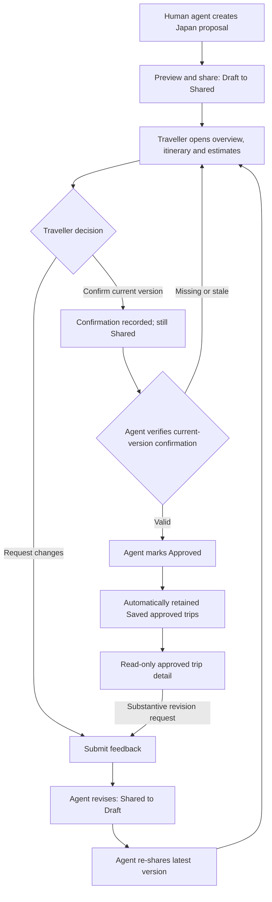

# TravelMate Sprint 2 — Final PDF requirements and traceability

**Authoritative source:** `TravelMate_Sprint2_READY_FOR_MOODLE.pdf` (28-page final consolidated submission, supplied by coordinator). This is a **text companion** to that PDF, not a claim that the PDF binary or its embedded screenshots are stored in GitHub.

## Submission identity
**Team:** Avengers Assemble · **Course:** MSc Computing, Software Development 2 · **Deadline:** 4 November 2026, 2:00 PM UK.
**Members:** Sanjay Kumar Devarai (A00100447), Sri Vishnu Vardhan Machidi (A00095273), Janardhan Reddy Kanala (A00093328), Dinakar Golla (A00102851), Venkata Harshavardhan Reddy (A00095792).

## Source-derived scope
TravelMate supports human travel-agent-assisted itinerary proposals. Sample scenario: traveller Emma Bennett (29), human travel agent Sophie Chen (32), Tokyo and Kyoto, 12–17 April 2027, six days / five nights, two travellers. Sample costs and dates are **illustrative**. Public destination videos stay on their original platforms. No live fare retrieval, guaranteed price, booking, payment or autonomous AI.

**Approval rule:** Traveller explicitly confirms the *current version*; the proposal remains **Shared** until the human travel agent verifies the confirmation and marks **Approved**. A substantive revision invalidates old confirmation and returns to Draft, followed by re-share and renewed confirmation. Approval is not booking.

## Complete user stories and acceptance criteria (PDF pp. 2–3)
| ID | Story | Acceptance criteria | Issue |
|---|---|---|---|
| US01 | Traveller registration | Required fields validated; duplicate email rejected; account created | #20 |
| US02 | Authentication | Role-appropriate access; invalid login rejected; logout ends session | #21 |
| US03 | Agent dashboard | Plan list displays Draft/Shared/Approved; open plan and start draft | #22 |
| US04 | Create proposal | Traveller, dates, itinerary saved; initial Draft | #23 |
| US05 | Revise proposal | Revision returns to Draft; confirmation invalidated; re-share | #24 |
| US06 | Itinerary days and activities | Days ordered; places, notes, activity times retained | #25 |
| US07 | Flight and cost estimates | Currency and assumptions shown; clearly indicative | #26 |
| US08 | Public video links | Agent manually checks source URLs; links open original platform | #27 |
| US09 | Preview and share | Completeness checked; Shared status; share reference | #28 |
| US10 | View shared proposal | Accessible shared six-day summary and destinations | #29 |
| US11 | Review itinerary | Day order, inclusions, indicative prices clear | #30 |
| US12 | Request adjustments | Feedback recorded; agent sees/revises; updated plan reshared | #31 |
| US13 | Review feedback | Agent sees feedback, version and revision summary | #32 |
| US14 | Confirm then agent approves | Confirmation version recorded; no auto-approval; only agent sets Approved | #33 |
| US15 | View confirmed plan | Approved proposal remains readable; no booking/payment implied | #34 |
| US16 | Delete plan (proposed) | Agent confirms deletion; any-state deletion is only proposed refinement | #35 |

## Agent-side wireframe specifications (PDF p. 4)
- **WF01 Agent dashboard:** status-filtered proposals, traveller brief, feedback alert, Create Proposal. US03, US13.
- **WF02 Proposal editor:** traveller/dates, Tokyo/Kyoto day cards, proposed flights, indicative costs, manually checked video URLs, Save Draft/Preview/Share. US04–US09.
- **WF03 Traveller proposal:** six-day overview, activity cards, costs, public videos, Request Changes. US10–US12.
- **WF04 Revision review:** version/change summary, traveller confirmation, agent-only approval, not a booking. US12–US14.
- **WF05 Authentication:** login/register validation, role-specific navigation. US01–US02.

## Seven traveller desktop wireframes (PDF pp. 5–14)
| Screen | Purpose | Actions and checks | Stories |
|---|---|---|---|
| 01 Shared proposal overview | Trip summary and six-day outline | View itinerary → 02; costs → 03; changes → 04; confirm → 05. Keep Shared, indicate £3,300 sample estimate. | US10, US11, US12, US14 |
| 02 Day-by-day itinerary | Six-day schedule and notes | Activity-specific change request preselects item in 04. Local JST and approximate travel times; links placeholders pending verification. | US11, US12 |
| 03 Flights and estimated costs | Indicative London–Tokyo / Osaka–London flights and GBP breakdown | Flights £1,800 + accommodation £750 + rail £300 + local transport £160 + activities £210 + planning £80 = £3,300 (two travellers); £1,650 each. No bookings or guaranteed availability. | US07, US11, US14 |
| 04 Request changes | Unsent change request | Day/activity and message required; Send records feedback, Cancel returns without altering plan. | US12 |
| 05 Confirmation received | Traveller confirmation receipt | Proposal **remains Shared**; Sophie must verify and approve. Confirmation is not payment or booking. | US14 |
| 06 Saved approved trips | Search/filter retained approved proposals | Automatically retained after agent approval; no extra Save/favourites step; authorised traveller/agent only. | US15 |
| 07 Saved approved trip detail | Read-only approved itinerary and estimates | Return to saved trips; Request revision; substantive change requires new proposal and approval cycle. | US15, US12 |

## User flow (PDF pp. 6–7)

## Other reference diagrams and evidence
The PDF includes two customer journeys (Emma and Sophie), create/share and review/revise/approve sequence diagrams, use case diagram, TourPlan state diagram and conceptual class diagram. Their exact visuals remain in the source PDF; the text summary here does not replace them.

Five genuine user-provided GitHub board screenshots are included in the PDF. Screenshots show Project #7 reused under title **TravelMate – Sprint 1**, board-wide totals **17 Todo / 0 In Progress / 9 Done**, and issue #38 in Done alongside #25–#27. These are screenshot observations, not independent implementation testing.

## Work ownership
- Sanjay (`sanjaydevarai5`): #21, #28, #35, #40
- Sri Vishnu (`machidisrivishnuvardhan03-code`): #20, #29, #30, #34, #36
- Janardhan (`janardhan1875`): #24, #31, #33, #37
- Harsha (`HarshaReddy180`): #25, #26, #27, #38
- Dinakar (`golladinakar`): #22, #23, #32, #39

**Submission state:** design artefacts prepared; team sign-off and Moodle submission receipt not verified. Do not close tasks or mark acceptance criteria complete solely because the PDF describes them.
