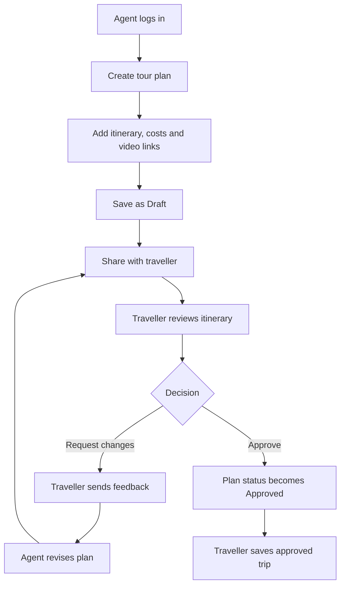
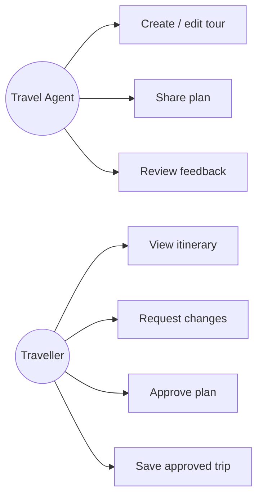
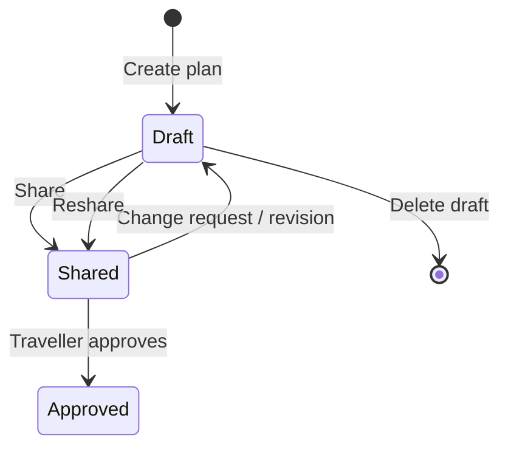
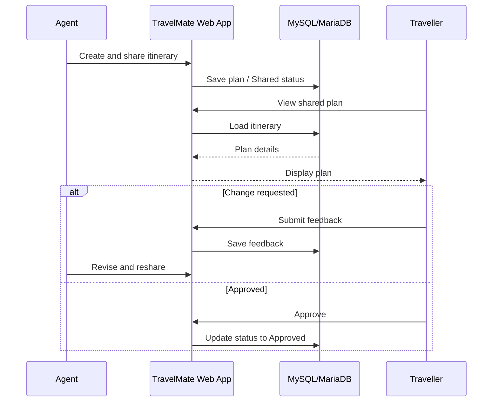
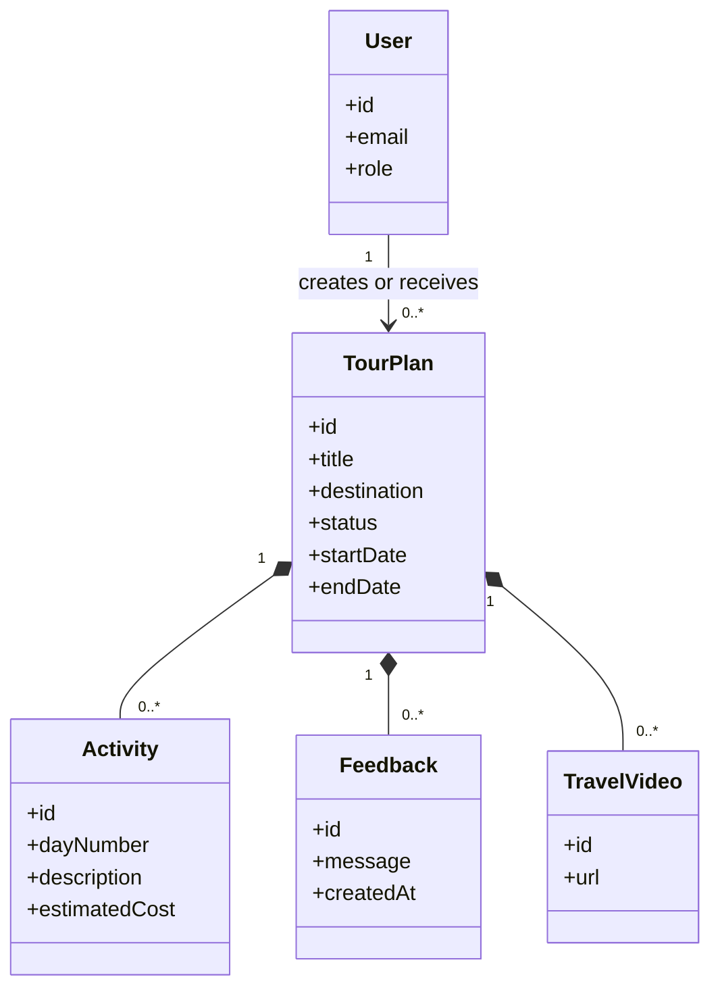

# TravelMate — Sprint 2 Design Pack

**Team:** Avengers Assemble  
**Repository:** https://github.com/sanjaydevarai5/TravelMate  
**Project board:** https://github.com/users/sanjaydevarai5/projects/7  
**Deadline:** 4 November 2026, 14:00 UK time

## Scope
TravelMate is an agent-assisted travel-planning application. Travel agents create and share itineraries; travellers review, request revisions, and approve plans. These are **proposed designs**, not claims that every feature is implemented.

## User stories and owners
Each linked GitHub issue contains the full user-story sentence and testable acceptance criteria.

| Story | Feature | Owner | Issue |
|---|---|---|---|
| US01 | Traveller registration | Sri Vishnu | #20 |
| US02 | Login and logout | Sanjay | #21 |
| US03 | Agent dashboard | Dinakar | #22 |
| US04 | Create tour plan | Dinakar | #23 |
| US05 | Edit tour plan | Janardhan | #24 |
| US06 | Destinations and activities | Harsha | #25 |
| US07 | Flight estimates and costs | Harsha | #26 |
| US08 | Travel video links | Harsha | #27 |
| US09 | Share tour plan | Sanjay | #28 |
| US10 | View received plans | Sri Vishnu | #29 |
| US11 | View itinerary details | Sri Vishnu | #30 |
| US12 | Request changes | Janardhan | #31 |
| US13 | Review feedback | Dinakar | #32 |
| US14 | Approve plan | Janardhan | #33 |
| US15 | Save approved trips | Sri Vishnu | #34 |
| US16 | Delete drafts | Sanjay | #35 |

## Wireframes — low fidelity

### Agent dashboard (US03, US04, US13)
```text
+--------------------------------------------------------------+
| TravelMate | Agent Dashboard                 [Profile/Logout] |
+---------------+----------------------------------------------+
| Dashboard     | My tour plans                                 |
| Create Tour   | [Create New Tour]                             |
| Feedback      | Draft: 3 | Shared: 2 | Approved: 1            |
|               | Title      Destination  Status   Actions      |
|               | Summer UK  London       Draft    Edit/Share   |
|               | City Break Paris        Shared   View         |
+---------------+----------------------------------------------+
```

### Tour-plan builder (US04–US09)
```text
+--------------------------------------------------------------+
| Create / Edit Tour Plan                                      |
| Title: [________________] Destination: [________________]     |
| Start date: [__________] End date: [__________]              |
| Day [1] Activity [___________________] [+ Add activity]      |
| Flight estimate [________] Currency [GBP v]                  |
| Other cost [________] Travel video URL [________________]    |
| [Save Draft]   [Share With Traveller]                         |
+--------------------------------------------------------------+
```

### Traveller itinerary (US10–US15)
```text
+--------------------------------------------------------------+
| My Travel Plans                         [Profile/Logout]     |
| Plan: Summer UK   Status: Shared                             |
| Destination: London   Dates: 10–15 July                      |
| Day 1: Arrival | Day 2: Museum | Day 3: City tour            |
| Estimated costs: Flight £___ Activities £___ Total £___      |
| Travel video: [Watch]                                        |
| Feedback [__________________________________________]         |
| [Request Changes]                         [Approve Plan]     |
+--------------------------------------------------------------+
```

### Login and registration (US01, US02)
```text
+------------------------------------+
| TravelMate                         |
| Email    [____________________]    |
| Password [____________________]    |
| [Login]        [Create Account]    |
| Error / validation message area    |
+------------------------------------+
```

### Feedback and approval (US12–US14)
```text
+--------------------------------------------------------------+
| Shared Plan: Summer UK                                       |
| Agent comments: [View feedback history]                      |
| Traveller feedback: [______________________________]         |
| [Send Change Request]        [Approve Plan]                  |
| Agent view: [Revise Draft]  [Reshare]                        |
+--------------------------------------------------------------+
```

## Activity flow


## Use-case diagram (conceptual)


## Tour-plan state diagram


## Sequence diagram


## Conceptual class diagram


## Sprint 2 evidence checklist
- [x] All 16 user-story issues created (#20–#35) and GitHub assignees set.
- [x] Five design/review issues created (#36–#40) and assignees set.
- [x] Draft wireframes and diagrams recorded in this file.
- [ ] Verify all issues are added to GitHub Project #7 and update actual statuses.
- [ ] Add a real board screenshot to the final submission PDF.
- [ ] Obtain team review of diagrams, user stories and scope.
- [ ] Upload final PDF to Moodle and verify submission receipt.

**Do not mark tasks Done solely because this design pack exists.**
